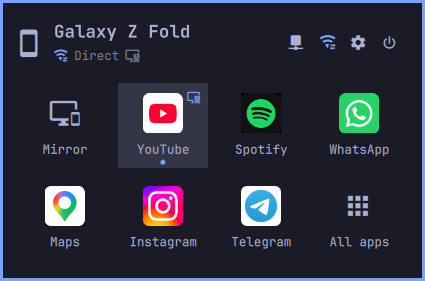
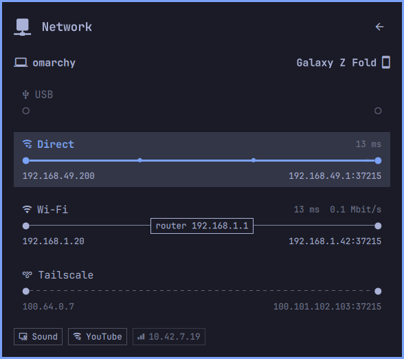

# omarchy-phonelink

Use your Android phone on [Omarchy](https://omarchy.org). Open phone apps in
their own windows, or mirror the whole screen, and control them with your mouse
and keyboard. Works over Wi-Fi, USB, or Tailscale when you're away from home.
The video quality follows your connection, and windows reconnect by
themselves when the network changes. Nothing to install on the phone.



## Install

Paste this into your AI coding agent (Claude Code, OpenCode, Codex…):

```
Install omarchy-phonelink from https://github.com/ljxw88/omarchy-phonelink.
Follow the AGENTS.md in that repo, then help me set up my phone.
```

Or by hand:

```bash
git clone https://github.com/ljxw88/omarchy-phonelink ~/.local/share/omarchy-phonelink
~/.local/share/omarchy-phonelink/install.sh
```

## Set up your phone (once)

1. **Settings › About phone › Software information**: tap **Build number** 7 times.
2. **Settings › Developer options**: turn on **Wireless debugging**.
3. On the computer: **Omarchy menu › Phone › Connection › Pair**.
   On the phone: **Wireless debugging › Pair device with QR code**, and scan it.

From then on, the phone connects by itself whenever Wireless debugging is on.

Samsung: if debugging is greyed out or the mouse doesn't work, turn off
**Settings › Security and privacy › Auto Blocker**.

## Use

Click the **phone icon** in the bar. Its network button shows how the
computer reaches the phone:



| Shortcut | |
|---|---|
| **Super + Alt + P** | Open an app |
| **Super + Alt + Shift + P** | Mirror the phone |
| **Super + Alt + V** | Sound here or on the phone |
| Right / middle click in a phone window | Back / Home |

## Away from home

If the phone and computer are on the same [Tailscale](https://tailscale.com)
network, phonelink reaches the phone from anywhere:

1. Connect once at home, so phonelink learns the phone's Tailscale address.
2. Away, keep the phone on Wi-Fi with Wireless debugging on.
3. Use it as usual. The bar icon shows "Tailscale".

If Wireless debugging was turned off and on, phonelink asks for the port the
phone shows under **Wireless debugging › IP address & port**. More in
[docs/reference.md](docs/reference.md#away-from-home-tailscale).

## Update or remove

Ask your agent to "update omarchy-phonelink" or "uninstall omarchy-phonelink",
or run:

```bash
git -C ~/.local/share/omarchy-phonelink pull && ~/.local/share/omarchy-phonelink/install.sh
~/.local/share/omarchy-phonelink/uninstall.sh
```

## More

Settings, commands, troubleshooting and privacy: [docs/reference.md](docs/reference.md).

Bug reports and pull requests are welcome: see [CONTRIBUTING.md](CONTRIBUTING.md).

Built on [scrcpy](https://github.com/Genymobile/scrcpy). MIT license.
